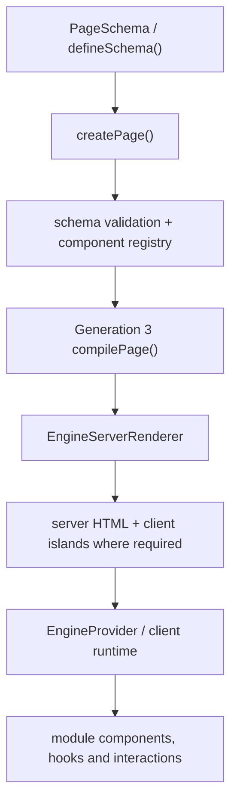
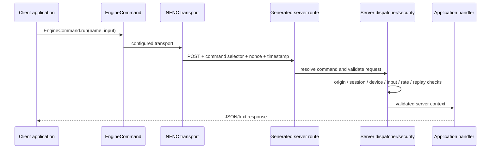

# How the Public APIs Work Together

This page maps the major public API families to each other. Read it as a system guide rather than a second list of every export; the exact signatures and types live in the [export inventory](./exports.md).

## 1. Page creation and rendering



- `defineSchema()` preserves the type of an authored page schema; it does not compile it.
- `createPage()` creates the Next.js page component and selects an eligible Generation 3 render path.
- The compiler exports are advanced APIs for tooling/inspection and custom integrations. Application code normally calls `createPage()`.
- The component registry resolves each schema node's `type` to a built-in or application-registered React component.
- The Generation 3 scoped registry starts with built-ins and isolates additional registrations per registry instance.

### Renderer selection is conditional

The current implementation uses the server-first renderer for eligible schemas. Supplying named handlers or setting `compiler.serverFirst: false` selects the compatibility/provider renderer. Supplying a scoped `EngineComponentRegistry` requires the server-first path. This is an eligibility rule, not a promise that arbitrary client components are server-rendered.

Related: [Create](./create.md), [Registry](./component-registry.md), [Compiler](./compiler.md), [NE architecture](../ne/architecture.md).

## 2. Component creation and registration

There are two different operations:

- `createComponent({ schema })` creates a reusable schema-backed React component.
- `createComponent({ mode: "custom", ... })` creates a typed adapter for a trusted local React component.
- `registerComponent(type, Component)` adds that component to the global registry.
- `createEngineComponentRegistry()` creates a scoped Generation 3 registry; its `registerComponent()` method is scoped to that instance.

Factory creation does not implicitly register a component. Registration determines how a schema node ID is resolved. Built-in node IDs cannot be replaced or unregistered.

## 3. Styling, EngineTheme and collected CSS

```text
createTheme() / theme reference
          ↓
theme resolver + validated tokens/slots/variants
          ↓
built-in or custom component theme binding
          ↓
schema props and explicit style overrides
          ↓
EngineStyleCompiler / style hooks
          ↓
StyleCollector → EngineProvider → emitted CSS
```

EngineTheme supplies visual defaults, variants, named slots, templates, fonts and syntax-highlighting integration. Node props and explicit styles overlay those defaults. EngineTheme data cannot replace the component's behavior contract or inject executable React code. Style collection is scoped to the rendering/provider path.

## 4. EngineAPIResolver and APIStatic

EngineAPIResolver is the request orchestrator. It can issue a normal HTTP request or route an API configuration to APIStatic.

```text
EngineAPIConfigParser
      ↓
providers + version macros
      ↓
EngineAPIResolver
      ├── string endpoint → fetch() + auth/header/body
      └── static endpoint → APIStatic.resolveRequest()
                               ↓
                         manifest + hashed browser module
                               ↓
                         validated operation
                               ↓
                         Response
```

- Provider configuration is read from `.EngineAPIConfig/*.api`; plugin compilation also writes a JSON build artifact.
- `ensureAPIConfig()` reads the configuration directory itself when there is no previously injected compiled configuration. It does not read the plugin's JSON output file as its source.
- APIStatic route programs are browser-executable static modules. They are not private Next.js route handlers.
- A proxy callback lets browser-side APIStatic code delegate a request, but the server proxy must validate targets, authorize the user and protect credentials.

Full setup: [EngineAPIResolver and APIStatic](./networking.md) and [Configuration](../configuration/index.md).

## 5. NENC and EngineCookies



- The client surface is imported from `nextjs-engine/network`.
- Server dispatcher/security factories are imported from `nextjs-engine/server`.
- The NENC Next.js plugin scans command declarations and generates a client/server manifest and route files.
- EngineCookies provides sealed payload storage, device identity/proof and trust metadata; it is not a browser cookie convenience wrapper.
- An authenticated request is not automatically authorized for every command: command policy and handler authorization remain server responsibilities.

See [Network API](./network.md), [Server API](./server.md), [NENC configuration](../configuration/nenc.md) and [security architecture](../ne/security/index.md).

## 6. Server request context

`EngineServer.open()` creates a request-scoped session using Next.js headers/cookies and server device detection. Its `fetch`, `fetchJSON`, `redirect` and `notFound` methods are wrappers over the server request environment. Use the `page(handler)` helper to create an async page wrapper.

The separate server entrypoint also hosts server-side CORS and the NENC enforcement APIs. It must never be bundled into a client component.

## 7. Metadata and SEO

```text
PageSchema / PageMeta / SEO schema
           ↓
EngineSEO.create() / createEngineSEO()
           ↓
resolve(props, parentMetadata)
           ├── generateMetadata() → Next.js Metadata
           ├── sitemap()          → MetadataRoute.Sitemap
           ├── robots()            → MetadataRoute.Robots
           └── jsonLd()            → JSON-LD data
                                     ↓
                           EngineSEOJsonLd component

Next.js SEO plugin → route scan / generated metadata routes
nextjs-engine/seo  → Open Graph ImageResponse helper
```

EngineSEO can infer title/description from a PageSchema, or accept an explicit SEO schema/builder. The build plugin scans route source files to derive sitemap entries. The image response helper is a server route concern, not a client component.

See [SEO API](./seo.md) and [EngineSEO module](../module/engineseo.md).

## 8. Graphics, animation, scroll and scheduling

- EngineCanvas creates/uses a scene and rendering engine (2D, 3D, SVG or Skia).
- EngineManim parses declarative animation input, compiles animation configuration/easing, then routes 2D or 3D animation data.
- EngineShader loads a compiled shader program and coordinates frame execution.
- EngineScroll coordinates point registration, movement/navigation, ranges, timelines, directors and point tracking.
- EngineScheduler shares visibility/work-priority and frame-pressure information across Gen 3 features such as Canvas, Shader and animated content.
- EngineViewport publishes a shared snapshot of visual/layout viewport geometry.
- EngineModel is a shared observable state primitive; the React hooks subscribe to model values.

These are cohesive public feature families. Their per-feature exported names/types are recorded in [exports](./exports.md), while the module pages describe behavior and examples.
